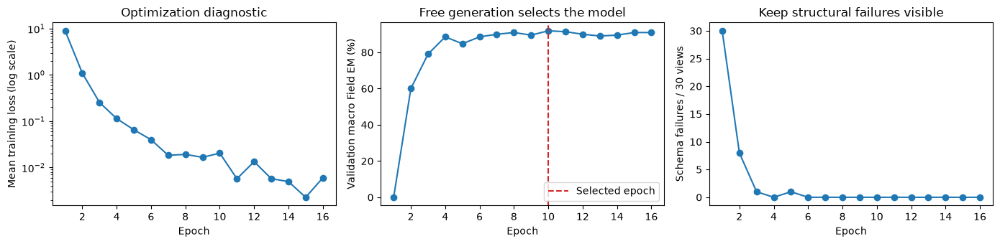

# Donut seven-field fine-tuning

**Executed 2026-10-15.** Adopt the validation-selected **epoch 10** from run
**`20261015T122657718426Z`** as the Phase 4 Donut comparator. This is frozen-encoder,
decoder-only adaptation with Adafactor, not full-model fine-tuning. It reaches
**193/210 normalized fields (91.90%)**, with no structural failures on the 30
validation views. OCR comparison and matched timing belong to the separate
[comparison report](ocr-donut-comparison.md).

Learning: [Donut training](../learning/donut-training.md).
Execution/review: [05b](../../notebooks/05b_donut_dataset.ipynb) and
[05c](../../notebooks/05c_donut_finetuning.ipynb).
The [experimental contract](../../EXPERIMENT_DESIGN.md) is unchanged.

## Question, data, and frozen selection

Can the pretrained Donut decoder learn the seven `alb_id` fields from whole-card
features on this consumer GPU, and what accuracy/failures remain on validation?
No assumption that it must outperform adopted OCR determines selection.

- MIDV-2020 `alb_id`: **70 training identities / 140 views**, **15 validation
  identities / 30 views**; template and rectified-photo pairs stay together.
- Existing [split manifest](../../splits/alb_id_v1.csv), seed 2026. Test remains
  sealed and supplies no training, selection, debugging image, or scoring result.
- Both views use the identity-matched template transcription. Photo VIA records
  provide geometry, not a complete second seven-field transcription table.
- Canonical 1084 × 680 RGB uint8 inputs; the photograph uses ground-truth corners.
  Donut internally processes a full landscape 640 × 1024 canvas with rotation
  disabled. No field crops or ground-truth rectangles enter its model.
- Targets use shared v1 normalization and fixed-order tagged serialization.
  Canonical escaping preserves literal delimiters, diacritics, and punctuation.
  All **170/170 targets** passed string and normalized token-ID round trips.
  Lengths were **37–43 tokens**, below the declared 192-token bound; no truncation.
- The original 57,525-entry vocabulary gains 15 task/field tokens, reaching
  **57,540**. Decoder embedding/output tables are resized together.
- No synthetic augmentation, identity lookup, field correction, fuzzy matching,
  routing, or test-guided exclusions are used.

The resource-selected training policy was written before main training and any
validation selection: [`donut_finetuning_v2.json`](../../configs/donut_finetuning_v2.json).
The original [`v1`](../../configs/donut_finetuning_v1.json) records the unsuccessful
AdamW diagnostic and is not the adopted training configuration. Serialization and
generation live in [`donut_dataset_v1.json`](../../configs/donut_dataset_v1.json).

Selection maximizes the mean of template/photo validation macro Field EM, then
minimizes pooled corpus CER, then keeps the earlier candidate. Training loss is
diagnostic. The budget was one main run, at most 24 epochs, with validation each
epoch and early stopping after six non-improving epochs once at least eight had
run. No validation-driven hyperparameter search followed the outcome.

## Parent, architecture, and resource compromise

Parent: `naver-clova-ix/donut-base`, exact revision
`a959cf33c20e09215873e338299c900f57047c61`. The selected model contains a Swin image
encoder and four-layer mBART-family decoder. After vocabulary expansion there
are **201,867,384 parameters**, of which **127,686,656 decoder parameters** are
trainable; the 74,180,728 encoder parameters remain fixed.

The [feasibility report](donut-feasibility.md) retains the complete optimizer-step
experiments and failures. Full checkpointed float32 training OOMed during
backward. Frozen-encoder AdamW OOMed at optimizer initialization. Moving frozen
encoder weights off GPU let two AdamW steps pass, but a later tiny diagnostic
still OOMed. A ten-step Adafactor follow-up passed with more headroom.

Consequently, the main run uses deterministic float32 pretrained encoder features
cached on CPU; encoder weights remain on CPU during decoder updates. The cache
contains whole-image features with pixel/split/encoder/policy provenance, not
reference text. During validation generation the encoder is temporarily moved
onto the GPU to keep the parent's generation device/cache behavior consistent.
During deployed inference each image is encoded anew. No training feature cache
is used by the comparison or public inference API.

Adafactor uses factored second-moment state and no first moment. Explicit learning
rates disable its automatic relative/parameter scaling; its update RMS clipping
is used without extra global gradient clipping. This is an optimization change,
not an identical-memory implementation of AdamW. The learning guide explains why
it was useful for the large decoder vocabulary matrix.

## Procedure and actual environment

The configuration owns exact values; the essential procedure was:

1. Prepare and hash deterministic whole-image features for all 170 permitted
   observations. An existing cache from a failed diagnostic was reused only
   after checking its file hash, exact pixels/order/splits, policy, and encoder hash.
2. Initialize a fresh candidate from seed 2026 and run a tiny training-only
   memorization check on both views of `alb_id/02`.
3. Discard its weights and optimizer, reset seed and parent weights, and create
   a fresh optimizer for main training.
4. Train with microbatch one, accumulation four, 35 optimizer updates per epoch,
   maximum learning rate 5e-5, 35 warm-up updates, then linear decay toward the
   maximum 24-epoch budget. Weight decay is 0.01. No padding/truncation is needed
   for the variable-length batch-one targets.
5. At each epoch, greedily generate each validation answer from only the task
   prefix and image features; parse and score every required field, including
   missing/structural failures. Save predictions and selection history.
6. Save the best model and its tokenizer/processor together. Verify the frozen
   encoder's entire state hash at the end. Stop according to the declared rule.

Machine: Intel i5-12400, 12 logical CPUs, 31.08 GiB RAM, GTX 1650 with 3726.38 MiB
visible to PyTorch; compute capability 7.5. Python 3.14.7; torch 2.14.1+cu130;
torchvision 0.29.1+cu130; Transformers 5.19.0; Pillow 12.3.0; NumPy 2.5.3;
pandas 3.0.5; OpenCV 5.0.0.93. Four PyTorch threads and one OpenCV thread were
experiment controls. Precision/attention were float32/eager. Exact platform and
packages are retained in the run's environment record and
[`requirements/phase4-recorded.txt`](../../requirements/phase4-recorded.txt).

Generation is fixed greedy batch-one with KV caching, a 192-new-token limit,
explicit task/BOS/EOS/pad IDs, and forced EOS disabled through direct arguments.
No decoding policy was searched using validation. The strict parser rejects
duplicates, malformed envelopes, and missing EOS as structural failures; it
retains parseable missing/extra keys for field scoring. Semantic validation does
not correct strings.

## Tiny diagnostic and main history

The tiny diagnostic reached **14/14 correct fields** after **20 optimizer updates**
on two views of **one training identity**, at the first declared generation check.
Its last teacher-forced loss was about 1.28. Greedy correctness does not require
loss zero. This is a wiring/memorization result, not independent accuracy evidence.
Main training reset the parent, random initialization of added rows, and optimizer.

The main run executed **16 epochs / 560 optimizer updates**; epoch 10 was the last
improvement, followed by six non-improving epochs. Main elapsed time was **293.97 s**,
including epoch validation and checkpoint saves, excluding feature preparation and
the tiny diagnostic. Peak allocated CUDA memory during main work was **1676.58
MiB**, reserved peak **2024 MiB**; validation temporarily co-located the encoder.

| Epoch | Mean training loss | Correct fields / 210 | Macro Field EM | Corpus CER | Schema failures / 30 |
|---|---:|---:|---:|---:|---:|
| 1 | 8.9723 | 0 | 0.00% | 100.00% | 30 |
| 2 | 1.0968 | 126 | 60.00% | 28.65% | 8 |
| 3 | 0.2546 | 166 | 79.05% | 9.88% | 1 |
| 4 | 0.1140 | 186 | 88.57% | 3.73% | 0 |
| 6 | 0.0400 | 186 | 88.57% | 1.76% | 0 |
| 8 | 0.0192 | 191 | 90.95% | 1.37% | 0 |
| **10 — selected** | **0.0205** | **193** | **91.90%** | **0.93%** | **0** |
| 16 | 0.0060 | 191 | 90.95% | 1.26% | 0 |

This table highlights milestones; the run retains all 16 epochs, including every
regression, in `history.json` and epoch-specific prediction/score files. Notebook
C plots the complete curves and independently replays **3360 field records**
using original annotations and the shared normalization. Every epoch's normalized
correct count and corpus CER matched. Raw-match columns in the original training
CSVs compare predictions with normalized targets and are not the primary metric;
the review's separate CSV retains original annotation references explicitly.



This figure is copied from the executed C review `20261015T123836282599Z`.

## Selected validation results and failures

| Source | Correct fields / Macro EM | Character edits / reference characters / CER | Complete documents | Structural/schema failures |
|---|---:|---:|---:|---:|
| Template | 99/105 — **94.29%** | 6/911 — **0.66%** | 10/15 | 0/15 |
| Photo | 94/105 — **89.52%** | 11/911 — **1.21%** | 6/15 | 0/15 |
| Pooled | 193/210 — **91.90%** | 17/1822 — **0.93%** | 16/30 | 0/30 |

| Field | Template matches / 15 | Photo matches / 15 |
|---|---:|---:|
| document_number | 14 | 13 |
| surname | 13 | 12 |
| given_names | 12 | 9 |
| date_of_birth | 15 | 15 |
| expiry_date | 15 | 15 |
| nationality | 15 | 15 |
| sex | 15 | 15 |

The **17 remaining errors** comprise 14 name fields and three document numbers.
Each costs one character edit in this selected result. **15/17 wrong fields still
pass semantic validation**; two photo document-number predictions violate the
shape rule. The full error table is displayed in C and saved in the original-
annotation review CSV; selected raw sequences/tokens remain in the run. No name,
number, or date correction hides these mistakes.

Excluding constant nationality as a diagnostic gives **163/180 fields (90.56%)**.
The primary score still includes it. This diagnostic is not cross-country or
unseen-layout evidence. Repeated validation selection and the small paired
sample mean these are development results, not untouched final test performance.

## Historical failures before the successful main run

All attempts remain under their original output directories:

| Run | Outcome and interpretation |
|---|---|
| `20261015T121455832353Z` resource probe | Adapter incorrectly expected photo field transcriptions; fixed to use identity-matched template truth. No model update or validation selection. |
| `20261015T121507255226Z` resource probe | Full checkpointed backward OOM. |
| `20261015T121606315164Z` resource probe | Frozen encoder plus AdamW OOM at optimizer initialization. |
| `20261015T121708609758Z` resource probe | Two frozen-feature AdamW steps passed; insufficient proof of later headroom. |
| `20261015T121944731579Z` diagnostic | AdamW tiny backward OOM before its first 20-step generation check; main training never started. Feature cache retained and later verified. |
| `20261015T122314734067Z` resource probe | Ten frozen-feature Adafactor steps passed. |
| `20261015T122419255168Z` diagnostic | At the 20-step tiny check, parent generation used the CPU encoder device for a CUDA decoder prefix. Main/validation selection had not started. |
| `20261015T122505302715Z` diagnostic | A decoder-only generation attempt exposed incompatible attention-cache behavior and a device-side assertion. Discarded; no main/validation selection. |
| `20261015T122620017299Z` generation smoke | **Invalid as image/cache parity evidence:** a positional cache index referred to `alb_id/00` validation template while the full-image call used `alb_id/02` training template. Identical untrained outputs did not establish matching inputs. The original summary is retained with an explicit audit correction. |
| **`20261015T122657718426Z`** | Successful tiny check, fresh-parent main run, validation selection, frozen-encoder hash check. |

The generation fix temporarily co-locates the encoder during parent generation
and moves it back before decoder updates. It does not change labels, model
capacity, checkpoint selection, or decoding parameters. Earlier engineering
failures are not presented as additional successful training seeds or hidden
validation searches. Failed run directories retain source/policy snapshots,
resource tracebacks or failure summaries as applicable; the first AdamW diagnostic
did not record an exact tiny-step count before its exception, so none is invented.

The final provenance audit caught the early smoke's unbound cache index. The
main run independently checked the complete cached metadata sequence against
identity/source/split/pixel hashes before any fitting, and final verification
matched correctly identified selected records across all 30 validation views;
those results are unaffected. A corrected two-view training-only check binds
the exact metadata tuple and compares encoder features directly as well as
generated tokens. Corrected run
[`20261015T130335944986Z`](../../outputs/phase4_generation_debug/20261015T130335944986Z/)
passed for **2/2 training views**, with bit-identical encoder tensors and matching
full/cached token sequences at correctly bound indices 4 and 5. It retains its
actual `procedure.py`; no weights were updated. The old run's
[audit correction](../../outputs/phase4_generation_debug/20261015T122620017299Z/audit_correction.json)
invalidates that smoke without editing its summary. Do not treat matching outputs alone as proof of matching
inputs: especially with an untrained task prefix, a model can repeat the same
answer despite an input mismatch.

## Artifacts, reproduction, and decision

Successful run:
[`outputs/phase4_finetuning/20261015T122657718426Z/`](../../outputs/phase4_finetuning/20261015T122657718426Z/).
Selected checkpoint:
[`checkpoints/phase4_finetuning/20261015T122657718426Z/best/`](../../checkpoints/phase4_finetuning/20261015T122657718426Z/best/).

The run stores policy/environment/source snapshots and hashes, cache provenance,
target audit, tiny losses/generations, all epoch losses/scores/predictions,
selection metadata, completion/memory, and unchanged encoder-state hash. Only the
selected weights are retained as `best`; nonselected epochs retain prediction
evidence, not a complete weight archive. Large artifacts are local and ignored.

```bash
.venv/bin/python experiments/prepare_donut_foundations.py
.venv/bin/python -m experiments.train_donut --config configs/donut_finetuning_v2.json
.venv/bin/python -m experiments.execute_phase4_notebook 05c_donut_finetuning
```

A new training run is a reproduction attempt, not a replacement for exact adopted
artifact hashes. Restore those artifacts to run the frozen path directly; do not
edit its hashes merely because retraining produces different bytes. The successful
run's source snapshots explain which code produced it.

The final [Donut manifest](../../configs/donut_pipeline_v1.json) records adoption
of epoch 10. Reload, full-image research/source parity, paired accuracy, and warm
latency are independently verified in the [comparison report](ocr-donut-comparison.md).
The result is a reproducible comparator on one known layout; it does not establish
general KYC capability, unseen-layout recognition, or degradation robustness.
