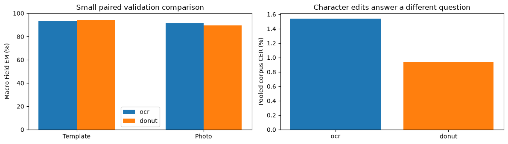
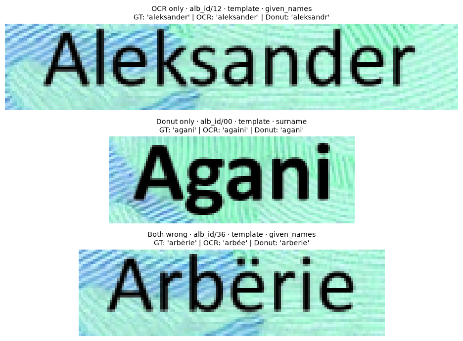
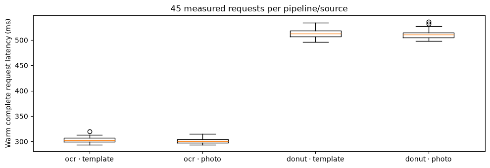

# Frozen OCR and Donut: paired validation comparison

**Executed 2026-10-15.** The selected Donut path is a comparable whole-card
extractor, with slightly lower validation Field EM and higher warm latency than
adopted OCR. Its different mistakes and lower CER are retained as evidence for
the later benchmark, without claiming a router will exploit them.

| Pipeline | Correct fields / 210 | Macro Field EM | Edits / 1822 chars / CER | Complete documents / 30 |
|---|---:|---:|---:|---:|
| Adopted OCR `ocr_v1` | **194** | **92.38%** | 28 — **1.54%** | **17** |
| Adopted Donut `donut_v1` | **193** | **91.90%** | 17 — **0.93%** | **16** |

Both produced structurally valid seven-field outputs for **30/30 validation
views**. These are **15 paired identities**, not 30 independent identities.
The test split was not loaded or scored. This is development evidence after
validation selection, not final test performance.

## Question, frozen paths, and fairness

The question is how the two declared pipelines compare on the same original
templates and rectified photographs once Donut has been adapted. It is not a
degradation sweep or a test of unseen layouts.

- Existing `alb_id` validation identities and seven required fields.
- Identical canonical **1084 × 680 RGB uint8** pixel arrays per observation,
  with hashes retained. Ground-truth corners isolate recognition from localization.
- OCR uses known field geometry and its frozen seven sequential crop calls;
  Donut uses the whole image. Neither receives reference values or identity labels.
- Both share the same normalization, semantic validation, Exact Match/CER scorer,
  reference annotations, hardware, float32 precision, and batch-one request unit.
- Models differ in their declared internal preprocessing and decoding. OCR keeps
  its established no-KV-cache policy; Donut uses its fixed autoregressive KV cache.
  These are model policies being compared, not hidden optimizations.
- Donut inference does **not** use the fixed-encoder feature cache used in training.

Current manifests: [`ocr_pipeline_v1.json`](../../configs/ocr_pipeline_v1.json)
and [`donut_pipeline_v1.json`](../../configs/donut_pipeline_v1.json).
The latter adopts epoch 10 of run `20261015T122657718426Z`; the
[training report](donut-finetuning.md) records selection and all regressions.
The experiment uses the unchanged [v1 contract](../../EXPERIMENT_DESIGN.md).

## Reload and notebook/research-to-source verification

Final source verification/comparison run: **`20261015T124404754152Z`**.

Before timed blocks, the verifier ran every validation image through the public
`DonutPipeline.extract` and an independent full-image research call. It compared
tokens, raw sequences, and parsed raw fields with the saved validation-selected
candidate's generated records:

- **30/30 complete generated token sequences and raw strings matched.**
- **210/210 raw field predictions matched.**
- Research and extracted serialization/parsing agreed on the retained sequences.
- All measured repeats retained the same tokens, normalized fields, and semantic
  validation outputs: **180/180 requests across both paths**, 90 per pipeline.
- Notebook C independently replayed **3360 saved validation field records** across
  all 16 epochs and reproduced every normalized count and corpus CER.
- Notebook D independently scored original annotation values, executed a live GPU
  request, and ran one CPU smoke request on validation template `alb_id/00`.
  CPU tokens and normalized fields matched the GPU result for that observation.
- **52 model-free unit tests** cover parsing, structural denominators, shared
  field behavior, input rejection, offline/corrupt loading, policy validation,
  and both request boundaries. A regular wheel built and imported independently
  from outside the checkout without initializing CUDA or changing thread pools.

The earlier full study **`20261015T123502967741Z`** remains historical. Review
then added a loader-only rejection of unsupported decode/attention metadata and
its test. The complete verification/timing study was repeated so the final
source hashes describe the shipped code. No model, generation rule, or selection
changed. Both named runs are retained rather than rewriting the old source hash.

An earlier untrained generation smoke used an unbound positional feature-cache
index and was invalidated during provenance review. It is not part of the
30-observation evidence above. Main training verified complete cache metadata;
the final comparator uses correctly keyed selected records and full-image
inference, with no training feature cache in its request path. The
[training report](donut-finetuning.md) retains the correction and corrected probe.

## Accuracy by source and field

| Pipeline | Source | Correct fields / 105 / Macro EM | Character edits / 911 / CER | Complete documents / 15 |
|---|---|---:|---:|---:|
| OCR | Template | 98 — 93.33% | 11 — 1.21% | 9 |
| Donut | Template | 99 — 94.29% | 6 — 0.66% | 10 |
| OCR | Photo | 96 — 91.43% | 17 — 1.87% | 8 |
| Donut | Photo | 94 — 89.52% | 11 — 1.21% | 6 |

| Field | OCR template / photo matches | Donut template / photo matches |
|---|---:|---:|
| document_number | 14 / 13 | 14 / 13 |
| surname | 11 / 11 | 13 / 12 |
| given_names | 13 / 13 | 12 / 9 |
| date_of_birth | 15 / 14 | 15 / 15 |
| expiry_date | 15 / 15 | 15 / 15 |
| nationality | 15 / 15 | 15 / 15 |
| sex | 15 / 15 | 15 / 15 |

Each entry has denominator 15 per source. Across both sources, Donut gains three
surname fields and one birth-date field but loses five given-name fields relative
to OCR. Document-number match counts tie, which does not imply identical errors.
The primary pooled difference is **one field / 210 = 0.48 absolute percentage
points** in OCR's favor. Donut's remaining errors cost fewer character edits,
so its CER is lower despite its slightly lower Field EM.

Constant nationality remains part of the primary score. Excluding it only as a
diagnostic gives OCR **164/180 (91.11%)**, Donut **163/180 (90.56%)**. Neither result
establishes cross-nationality or unseen-layout recognition.



## Complementary failures and qualitative evidence

Paired **field-level**, development-only outcomes:

| Outcome | Required fields / 210 |
|---|---:|
| Both correct | 181 |
| OCR only correct | 13 |
| Donut only correct | 12 |
| Both wrong | 4 |

Donut has 17 wrong fields: 14 names and three document numbers; **15/17 still pass
semantic validation**. Its two invalid-looking errors are photo document numbers.
OCR's earlier remaining name/number/date errors are retained too. Shape validation
is not calibrated confidence or proof of identity correctness.

Notebook D displays all Donut errors and diagnostic pixel crops for one OCR-only,
one Donut-only, and one shared failure, with references and both predictions.
Those crops explain errors; they were never Donut inference inputs. Full
sample-level generations and the 210-row paired field table remain in the run.

These counts are **not a document-routing oracle**. A deployable selector cannot
see correctness/reference values, and a document's fields can favor different
models. Phase 5 must examine complementarity over its controlled workload;
Phase 6 must test whether permitted observable signals predict a useful route.



## Matched latency and memory

The protocol was frozen before comparison in
[`ocr_donut_comparison_v1.json`](../../configs/ocr_donut_comparison_v1.json):

- One individually resident pipeline at a time, same device and thread controls.
- Block order **OCR, Donut, Donut, OCR, OCR, Donut**; the middle repeat pair reverses
  order. This is three paired repetitions, not a perfectly balanced even-pair design.
- Each block has three warm-up template and three warm-up photo requests, excluded
  from reported distributions, then one shuffled pass through all 30 observations.
- Matching repetition indices use the same seeded observation order for each model.
- **90 measured requests per pipeline**, **45 per pipeline/source**; six blocks total.
- CUDA synchronization at generation/request boundaries. Model loading, dataset
  loading, geometry, reference scoring, result checking/writing, and plots are
  excluded. In-memory preprocessing, transfer, full model generation, decoding,
  strict parsing, normalization, and validation are inside the request boundary.
- The artifact verification/research parity phase ran before the timed blocks;
  no reference call or feature cache is interleaved inside measured requests.

Final-run measurements:

| Pipeline/source | Requests | Generation mean / median | Complete request mean / median |
|---|---:|---:|---:|
| OCR template | 45 | 294.99 / 294.24 ms | **303.00 / 302.00 ms** |
| OCR photo | 45 | 293.34 / 292.58 ms | **301.33 / 300.59 ms** |
| Donut template | 45 | 499.72 / 500.08 ms | **512.73 / 512.95 ms** |
| Donut photo | 45 | 498.74 / 497.48 ms | **511.68 / 510.44 ms** |

Pooled complete-request means are approximately **302.17 ms OCR** and
**512.21 ms Donut**, about **1.70×** Donut/OCR on this workload. The earlier run's
means were approximately **286.14 ms OCR** and **484.12 ms Donut**, with the same
accuracy. Both paths took longer in the later session repeat. This variation is
retained, not attributed to the loader-only change or used to claim a speedup.
The two-session range is not a confidence interval or a controlled clock/thermal
experiment. Desktop activity and hardware state were not eliminated.

The first run's measured block peaks were **255.26 MiB allocated / 272 MiB
reserved for OCR**, versus **1144.85 MiB allocated / 1298 MiB reserved for Donut**.
The final run retains its own per-block memory in `blocks.json`; the memory table
in D reads those records. GPU peaks include model weights; CPU RSS also includes
the loaded evaluation data/notebook-independent Python environment. They are not
incremental activation estimates or a portable hardware sizing guarantee.

Recorded machine: Intel i5-12400, 12 logical CPUs, 31.08 GiB RAM, GTX 1650
(3726.38 MiB visible); Python 3.14.7, torch 2.14.1+cu130, torchvision
0.29.1+cu130, Transformers 5.19.0. Four PyTorch threads and one OpenCV thread.
Exact environment and direct version records are retained. No p95/p99 service,
throughput, queue, concurrency, or load-aware routing claim follows from this
warm local extraction experiment.



These tracked figures are copied from D review `20261015T124934943868Z`.

## Reproduction and saved evidence

```bash
.venv/bin/python -m experiments.compare_ocr_donut
.venv/bin/python -m experiments.execute_phase4_notebook 05d_donut_evaluation
.venv/bin/python -m unittest discover -s tests -v
```

The [comparison script](../../experiments/compare_ocr_donut.py) verifies the
frozen manifests and refuses test access through the shared research adapter.
Restore exact models/data as described in [Donut usage](../guides/donut-usage.md).
The current-source study is
[`outputs/phase4_comparison/20261015T124404754152Z/`](../../outputs/phase4_comparison/20261015T124404754152Z/);
the [earlier run](../../outputs/phase4_comparison/20261015T123502967741Z/) remains
an immutable measurement snapshot.

Each run stores actual source/config snapshots and hashes, environment, all
verification outputs, raw predictions/tokens, field/document/per-field summaries,
paired fields, 180 request timings, block memory, and completion assertions.
Notebook D's separately named review stores its GPU/CPU smoke result and plots.
Large evidence/model directories are Git-ignored; executed notebook outputs and
the reports remain available in the repository.

The [delivery record](../phases/phase-4.md) inventories the final source/package,
tests, notebooks, configuration, documentation, and the Phase 5 handoff. Both
paths are frozen comparators; no router, degradation sweep, predicted localizer,
service, or deployment is introduced by this phase.
