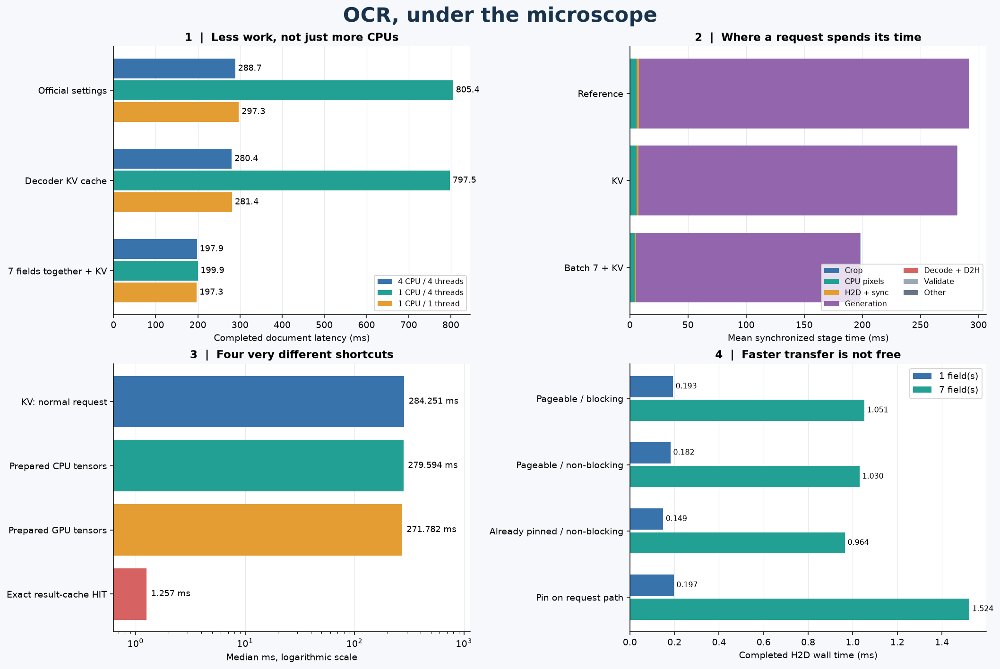
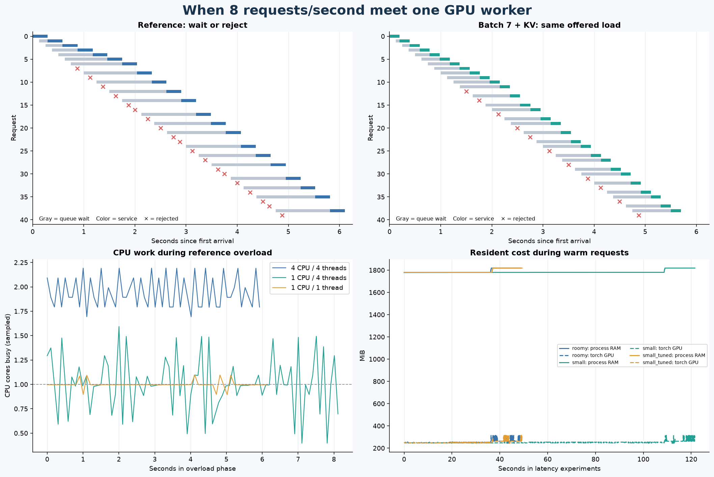

# OCR under the microscope

**The surprise: a GPU pipeline can be slowed down by its CPU thread policy.**
This curiosity lab uses the selected fine-tuned TrOCR candidate on the GTX 1650.
It changed no official pipeline settings and did not itself close Phase 3.
See the [Phase 3 delivery record](../phases/phase-3.md) for current status.

## The tiny “pod” experiment

Real, temporary Linux cgroups enforced **4 GiB RAM, no swap**, and either a
**4-CPU or 1-CPU time quota**. A separate **1 GiB PyTorch GPU-allocator cap**
also applied; that is not GPU isolation or a compute quota. Existing desktop
and notebook processes were left alone.

Each case measured 60 warm documents: both sources for 15 validation identities,
twice. All **540 timed requests preserved every predicted field exactly**,
including the experimental cache/batch variants. Test data stayed sealed.

| Worker budget / thread policy | Sequential | KV cache | Seven fields batched + KV |
|---|---:|---:|---:|
| 4 CPU / 4 threads | 288.7 ms | 280.4 ms | 197.9 ms |
| 1 CPU / 4 threads | 805.4 ms | 797.5 ms | 199.9 ms |
| 1 CPU / 1 thread | 297.3 ms | 281.4 ms | 197.3 ms |

Values are median completed document times. The third row was a documented
follow-up control after observing throttling. Aligning thread pools with the
one-CPU budget made sequential inference **2.7× faster without another CPU**.
It changes PyTorch/OpenMP/BLAS thread policy together; it does not identify one
library's internal waiting mechanism. In the reference timing phase, the
oversubscribed worker was throttled in 498 quota periods; the roomy worker in zero.

Batching means seven fields of **one document**, not seven users. On the roomy
worker it reduced median latency by **31%**, at the cost of more peak GPU memory:
**256 → 328 MiB allocated**, with up to **384 MiB reserved**. Overall cgroup RAM
peaks were **1.17–1.37 GiB**; sampled process RSS was **1.80–1.99 GiB**. Shared-page
accounting makes those different quantities. No memory-limit or OOM events occurred.

## Where the time goes—and what “cache hit” means

For the roomy reference worker, mean document cost was **292.3 ms**:
**284.1 ms generation**, **5.85 ms CPU pixel processing**, **1.68 ms H2D**, and
about **0.6 ms everything else**. Generation includes CPU launch/wait overhead,
not just GPU execution.

One processed field is **1.69 MiB**; seven are **11.81 MiB**. A packed seven-field
copy took **1.05 ms** normally, **0.96 ms** with already-pinned memory, but
**1.52 ms** when pinning was added on the request path. Optimizing this small
fraction cannot transform a 290 ms request. Non-blocking copies were timed to
completion, not just submission; no copy/compute overlap was attempted.

Decoder KV cache helped only modestly here: **289 → 280 ms**. Prepared CPU/GPU
inputs also saved little on three repeated observations: **284 → 280/272 ms**.
Those latter tests exclude cache-fill cost and should not be read as universal
speedups. Their three-document cache occupied **35.4 MiB on each device**.

An exact **result-cache hit was 1.26 ms**, versus three initial misses around
**278 ms**. It skipped OCR entirely. The hit includes image/geometry hashing,
versioned lookup, and response reconstruction—not a preknown identity lookup.
The eight-slot LRU intentionally received 60 hits: this is **not a predicted
production hit rate**, and a different photo must miss.

The first process-local reference request took **910 ms**, versus 289 ms warm.
Processor loading, CPU model loading, and moving weights took another
218/116/177 ms respectively. Imports and data preparation are additional;
weights were local and OS file caches were not flushed. This is not a cold-disk test.

## Overload: fast service is not fast response

One GPU worker, four pending slots, actual paced arrivals, five seconds at
**8 requests/second**. Full queues reject immediately. These p95s cover completed
requests, so rejection counts must be read alongside them.

| Worker | Reference completed / rejected | Reference response p95 | Batched completed / rejected | Batched response p95 |
|---|---:|---:|---:|---:|
| 4 CPU / 4 threads | 21 / 19 | 1.45 s | 29 / 11 | 0.97 s |
| 1 CPU / 4 threads | 9 / 31 | 4.52 s | 29 / 11 | 1.00 s |
| 1 CPU / 1 thread | 21 / 19 | 1.47 s | 29 / 11 | 0.98 s |

The gray sections are **waiting**, not inference. Batching improved capacity
but did not make 8 requests/second sustainable. A 12-request simultaneous burst
completed four and rejected eight in each worker: admission policy matters too.
The quieter 1.5 requests/second case already queued on the oversubscribed worker.

## Explore it

- [Executed notebook](../../notebooks/04e_ocr_resource_lab.ipynb): tables, resource plots, transfer results, and the [CPU/CUDA kernel timeline](../figures/ocr-resource-profile/trace.png).
- [Learning notes](../learning/ocr-resource-profiling.md): synchronization, memory accounting, cache validity, quotas, and queues.
- [Worker implementation](../../experiments/ocr_resource_profile.py) and [analysis](../../experiments/ocr_resource_analysis.py).
- [Frozen initial policy](../../configs/ocr_resource_profile_v1.json) and [thread-control amendment](../../configs/ocr_resource_profile_thread_control_v1.json).
- Local [raw artifacts and traces](../../outputs/ocr_resource_profile/20261012T235119768783Z/) for run `20261012T235119768783Z`.

This is a short, ordered, single-machine demonstration—not a concurrent-service
SLA or the later official load benchmark. Input starts at canonical RGB in RAM;
HTTP, uploads, JPEG decoding, rectification, and independent GPU isolation are
out of scope. Profiler-instrumented timings are kept separate. No model was
retrained, checkpoint overwritten, or official decoding policy changed.

**Takeaway:** right-size threads first, batch useful work next, and optimize
copies only when the measurements justify it. Keep queues bounded—and never
confuse a result-cache hit with faster recognition of a new document.
