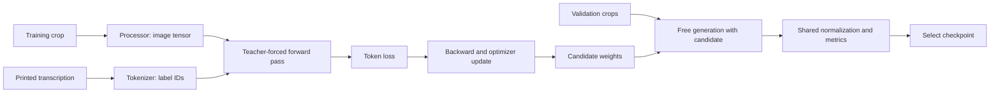

# How the OCR fine-tuning experiment works

Read this with [04d_ocr_finetuning.ipynb](../../notebooks/04d_ocr_finetuning.ipynb).
The notebook is the complete executable implementation. The
[versioned configuration](../../configs/ocr_finetuning_v1.json) records the
experiment choices; the [report](../experiments/ocr-finetuning.md) records what happened.
For prerequisites, see [OCR](OCR.md), [generation and attention](ocr-generation-and-timing.md),
and [evaluation](ocr-evaluation.md).

## The problem we are adapting to

The pretrained model already converts an image crop into tokens. We keep its
architecture, tokenizer, crop geometry, processor, and scoring rules. Fine-tuning
updates learned weights using examples from this document domain. It is not
training a recognizer from random initialization.

The baseline exposed repeated recognition errors in readable crops: nationality,
date separators, year digits, names, and `F` confused with `5` or `E`. That is a
specific reason to try adaptation. A lower aggregate score alone would not tell
us whether training is appropriate; a crop cut in half or text erased by glare
would need a different explanation.

The intervention is supervised learning on crop/transcription pairs. Its intended
effect is to change how the model uses visual features and generates text. We
do not add a lookup that replaces wrong outputs with expected values.



Training labels determine gradients. Validation answers determine checkpoint
selection, not gradients. Those are different routes by which data influences
the eventual model, so both require split discipline.

## Data lineage and exclusions

The identity manifest, not an arbitrary image shuffle, determines the split.
All observations derived from one identity inherit its split. There are 70
training identities and 15 validation identities; test identities remain sealed.

Two sources and seven fields would produce `70 × 2 × 7 = 980` training pairs.
Phase 2 documented glare-erased text in two of them. We remove photo
`alb_id/61` document number and photo `alb_id/63` sex from supervised fitting,
leaving 978. Their other fields and templates remain. This exclusion policy was
specified before training and is unrelated to validation predictions. No
validation field is removed from evaluation.

An annotation is not proof that its answer is visible in the crop. Training on a
hidden answer can reward memorization of unrelated image features. Keeping an
exclusion manifest makes this judgment auditable. No new performance-driven
training exclusions are made in this experiment.

Each retained manifest entry records identity, source, field, original target,
target tokens, crop shape, and crop-pixel hash. The model receives only image
pixels and target token IDs during fitting. It is not supplied identity keys or
field names as predictive inputs.

We train the printed transcription rather than the normalized evaluation value.
For example, `15-10-1973` remains day-first in training. The model should read the
image; the existing postprocessor converts supported dates to canonical form.
Case, punctuation, and diacritics in annotations are preserved. Tokenizer
round-trip checks ensure the target can be represented without unknown tokens or
silent truncation. The longest observed target has 10 tokens, including special
tokens, below the generation length limit of 20.

Templates/photos are related observations, not independent identities. A larger
number of crops does not imply a larger number of people or documents. The same
caution applies when interpreting validation confidence.

## Dataset, DataLoader, and collator

The Dataset maps an integer index to a crop and transcription. It does not choose
learning rates, shuffle identities, or compute metrics. CPU memory holds the
small RGB crops; we do not cache a GPU tensor for every training example.

The DataLoader determines iteration order and microbatch size. We use a seeded
shuffle of training examples, batch size one, and zero worker subprocesses for
an inspectable single-machine implementation. A fixed generator gives repeatable
orders within the recorded software environment.

The collator converts examples into a model-ready batch:

- the processor creates float32 pixel tensors;
- the tokenizer converts target strings to token IDs;
- target sequences are padded to the longest sequence in that batch;
- padded label positions become `-100`;
- a shifted attention mask identifies valid decoder input positions.

The two-example demonstration makes padding visible even though the actual
microbatch size is one. The same collator supports unequal target lengths without
hardcoding a label width or dropping EOS tokens.
Image tensors are floating point because pixels are numerical model inputs;
labels are integer class IDs, not continuous numbers to regress toward.

## Teacher forcing and shifted decoder inputs

Suppose the desired tokens are `[A, B, EOS]`. Training should ask the model to
predict `A` from the start token, `B` from the correct prefix `A`, and `EOS` from
the correct prefix `A, B`. The decoder inputs and labels are offset by one:

```text
decoder inputs: START, A, B
target labels:      A, B, EOS
```

Our actual tokenizer also supplies its normal special tokens. The
`VisionEncoderDecoderModel` prepares shifted decoder inputs from labels
internally. Ignored label entries are replaced with padding when constructing
those inputs; `-100` is not a vocabulary token. The attention mask is shifted
consistently and includes the valid start position.

Providing the correct previous token is teacher forcing. It makes supervised
optimization efficient, but differs from use at inference time: during generation
the model must continue from its own predictions. An early wrong token can then
affect later ones. This training/inference difference is one reason to evaluate
free generation, rather than selecting models by training loss alone.

The relevant API behavior is documented in the
[VisionEncoderDecoder training reference](https://huggingface.co/docs/transformers/model_doc/vision-encoder-decoder#training).
The implementation uses the installed library's forward interface and checks the
result through actual optimization and generated predictions.

## Cross-entropy and ignored padding

For each supervised position, the decoder produces one logit per vocabulary
token. Softmax converts logits into a distribution. If the correct token has
probability `p`, its negative log-likelihood is `-log(p)`. Assigning it probability
0.9 costs about 0.105; assigning 0.01 costs about 4.605. Confident mistakes are
therefore expensive.

Cross-entropy averages the costs at nonignored label positions. `-100` marks
padding that must not contribute. Otherwise a model could lower its loss by
learning padding rather than the transcription. Genuine EOS remains a target so
the decoder learns when to stop.

The notebook's loss is a mean over valid target tokens for each microbatch, then
gradients are averaged over crops in the accumulation group. Consequently each
crop has equal weight, rather than longer transcriptions automatically receiving
more weight. The epoch loss is the mean of those crop losses. That convention is
recorded and is not the same as corpus CER or macro Field EM.

Loss is a differentiable optimization objective; Exact Match is a discontinuous
decision metric. A small probability improvement may reduce loss without changing
the selected next token. Conversely, changing one critical token can improve EM
substantially. Both curves are useful but answer different questions.

## Backpropagation and parameter updates

The forward pass calculates representations, logits, and loss. Backpropagation
uses the chain rule to calculate how the loss changes with trainable weights.
The optimizer uses these gradients to update the weights. We clear accumulated
gradients after every optimizer update so previous groups do not accidentally
continue contributing.

`requires_grad=False` freezes a parameter. `model.eval()` controls training-specific
layer behavior such as dropout. These are different mechanisms. For decoder-only
training, the overall model trains while the frozen encoder is explicitly kept
in evaluation mode; its visual representation stays fixed and deterministic
with respect to dropout. The encoder-to-decoder projection remains trainable.
During joint training both parts train. For validation every part enters eval
mode and generation runs without autograd.

We check loss and gradient norms for finite values. A NaN is a reason to stop and
diagnose the run, not a value to hide from the logs. Gradient clipping bounds the
global norm at 1.0 before the optimizer step. It controls unusually large updates
but does not guarantee generalization or cure incorrect labels.

## AdamW, learning rates, and weight decay

AdamW maintains running estimates of gradients and their squared magnitudes to
scale updates adaptively. Its weight decay shrinks weights separately from the
gradient-derived update. This discourages unconstrained parameter growth but
does not make memorization impossible.

The implementation groups trainable parameters by their learning rate and decay
policy. Encoder parameters use the encoder rate. Decoder and bridging projection
parameters use the decoder rate. Biases and one-dimensional parameters have zero
decay; other trainable parameters use 0.01. This keeps the choice explicit rather
than relying on an implicit trainer default.

Stage A freezes the encoder and uses decoder learning rate `1e-5`. Stage B
starts from Stage A's best checkpoint, using `3e-6` for the encoder and `5e-6`
for the decoder/projection. The smaller encoder rate is a cautious adaptation
choice: useful visual features should not be overwritten rapidly by a small
dataset. These are prespecified experiment choices, not universal best values.

Both stages plan five epochs. Five percent of the planned optimizer updates
warm up the learning rate, then it decays linearly. Warm-up avoids immediately
applying the full rate to a new optimization trajectory. Decay reduces update
size later. The scheduler advances once per optimizer update, not once per crop.
Stage B starts a fresh optimizer and scheduler; it inherits selected weights,
not Stage A's momentum estimates.

## Microbatches and gradient accumulation

An effective batch of eight would ordinarily hold activations for eight crops.
Instead we process one crop at a time, divide its loss by eight, backpropagate,
and accumulate gradients. After eight crops we clip and update once. Their
gradients sum in the parameter buffers without retaining eight computation
graphs simultaneously.

The last group is smaller: `978 = 122 × 8 + 2`. Its two losses are divided by
two, not eight. Each full epoch therefore has 123 optimizer updates. Dividing
the last group by eight would silently give those examples less influence.

Accumulation reproduces an average of microbatch gradients, subject to numerical
and training-mode details. It does not magically turn all microbatch behavior
into that of one larger batch. Here the explicit per-crop token-mean convention
also matters when target lengths differ.

## Memory and gradient checkpointing

Training requires more memory than inference: activations, gradients, and
optimizer state accompany the weights. The desktop and other kernels also use
GPU memory. We leave those processes alone and measure our own allocation.

Freezing the encoder reduces gradient and optimizer storage for it and avoids
retaining its backward graph. Joint training enables non-reentrant gradient
checkpointing, which recomputes intermediate activations during backward instead
of keeping all of them from forward. It trades extra computation for reduced
activation memory. It is unrelated to saving model weights to disk, despite the
shared word "checkpoint."

Decoder KV caching stays disabled in training and in the comparison generation
config. Caching is designed to reuse inference prefix computations; it is not
needed for the teacher-forced full-sequence training pass. We keep float32 for
this experiment and record memory/time rather than claiming mixed precision
will necessarily help on this device. The relevant controls are exposed by
[Transformers model utilities](https://huggingface.co/docs/transformers/main_classes/model#transformers.PreTrainedModel.gradient_checkpointing_enable).

## Why intentionally memorize eight examples?

The sanity check uses eight training crops and a larger learning rate `1e-4`,
with fixed update/time limits. Exact reproduction of this tiny set confirms
that the model can use the labels through the chosen training path. It catches
mistakes such as disconnected gradients, incorrect target shifting, or loss
computed mostly on padding.

Memorizing eight examples says nothing about unseen identities. We explicitly
discard that model and optimizer and reload the original weights before Stage A.
Otherwise the diagnostic would become an undocumented part of initialization.
The sanity history and generated strings remain in the artifacts.

## Selecting weights without changing the question

After each epoch, the model generates all seven fields for each of 30 validation
observations. The scorer applies exactly the existing shared normalizers and
validators. It does not supply correct text to generation. Template and photo
macro Field EM receive equal weight in the selection score.

Ties minimize pooled normalized CER; an exact tie keeps the earlier candidate.
The untouched pretrained model is eligible, so training is allowed to fail
without forcing adoption. Two successive nonimproving epochs stop a stage.
A shared one-hour wall budget includes fitting, validation, and weight saving;
an in-progress epoch can be evaluated as a clearly labeled partial candidate
if that budget is reached.

Only the best weights within each stage are stored, while every epoch's
predictions and scores are retained. Stage B begins from Stage A's selected
checkpoint, not the last training state. This is an adaptive two-stage procedure,
not an independent replication. Repeated validation selection introduces
optimism; an untouched test evaluation is reserved for the later comparison.

The checkpoint is reloaded after selection and its generated predictions must
agree exactly. This verifies that local saved artifacts reproduce the selected
result. Weight/config/tokenizer hashes identify what was evaluated. Optimizer
histories document the run, but the saved best checkpoints are inference
artifacts, not full mid-epoch resumable optimizer snapshots. Reproduce training
from the pinned initial checkpoint and configuration.

The implementation seeds Python, NumPy, PyTorch, CUDA, and the DataLoader's
shuffle generator. CPU thread counts and major software versions are recorded.
This controls important sources of variation; it does not promise bitwise
identical training across different hardware or library versions. Within the
recorded run, saved-checkpoint reload and repeated generation are checked exactly.

## Read improvement, regression, and remaining uncertainty

Every field is classified as fixed, regressed, still correct, or still wrong
relative to the baseline. Report per-field and source-specific counts, not just
one average. Retain CER and Document EM because a small character error can make
an entire record unusable. Inspect crop galleries for remaining failures.

Nationality has the same target across this dataset. Learning that constant can
improve seven-field accuracy without establishing general recognition. We report
accuracy over the other six fields as well. Even that score can reflect dataset
layout/font regularities; 70 training identities do not establish robustness to
new document types, countries, or capture conditions.

Fine-tuning can also change tokenization of generated strings: preserving mixed
case rather than emitting uppercase may require a different token sequence.
The architecture stays the same, but more generation steps can change latency.
Both original and selected weights are timed in the same session, with the same
canonical-input boundary, synchronization, warm-ups, precision, batch size, and
decoding rules. All repeated predictions must match their respective accuracy
runs. These are warm local measurements, not concurrent serving measurements.

The experiment may recommend a candidate, but it does not close Phase 3. Final
pipeline freezing, source extraction, and the untouched test comparison remain
separate decisions.
